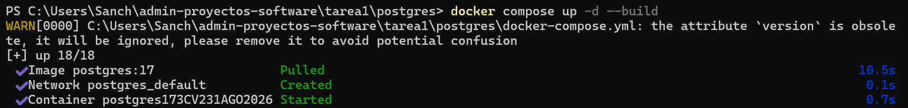
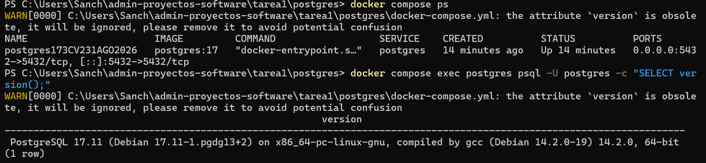
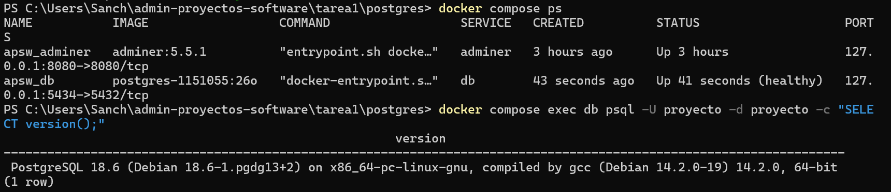
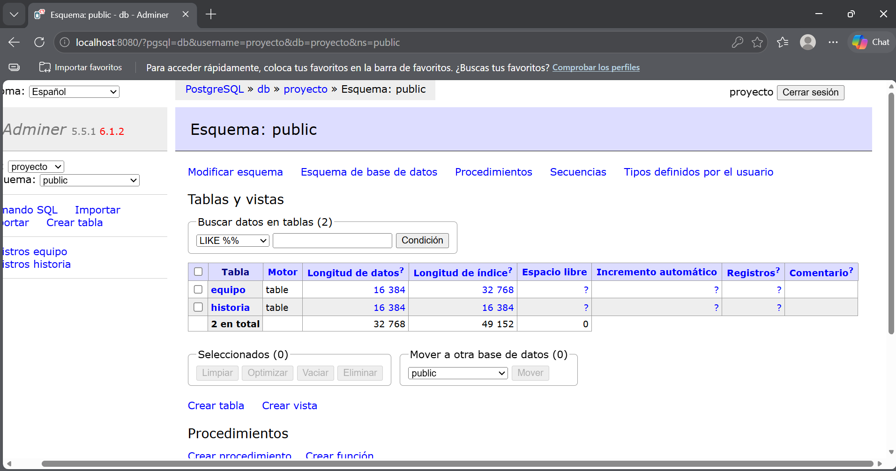
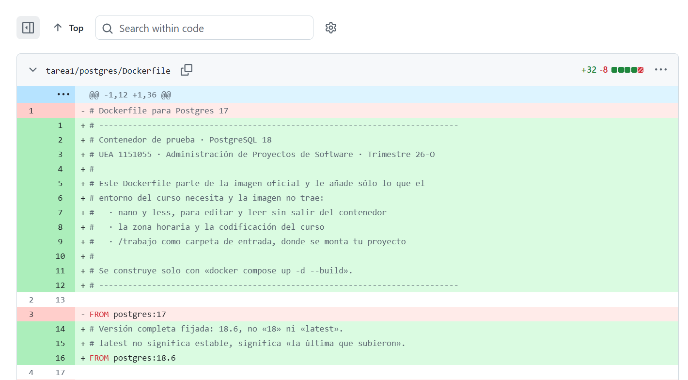
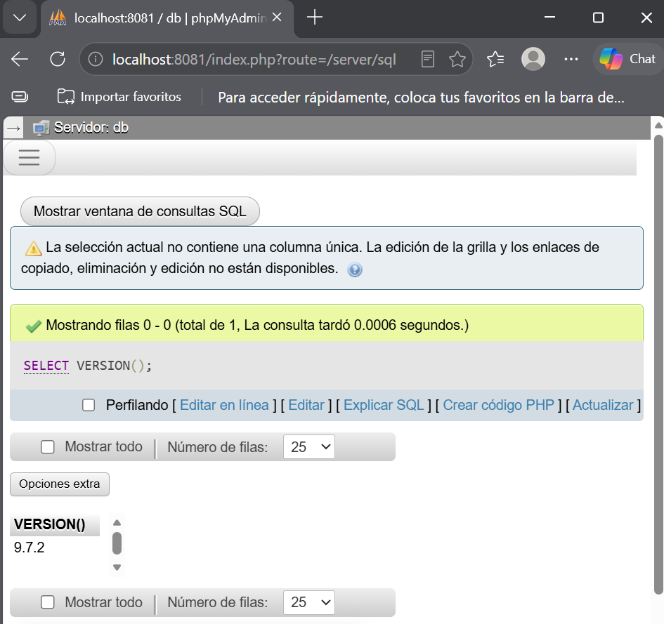
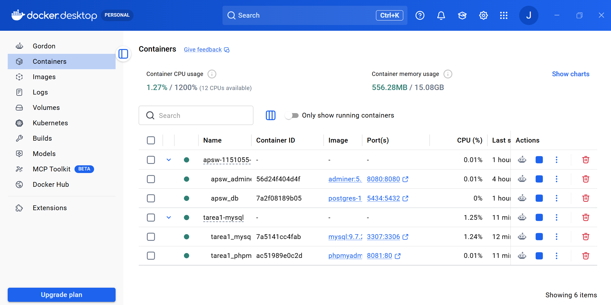
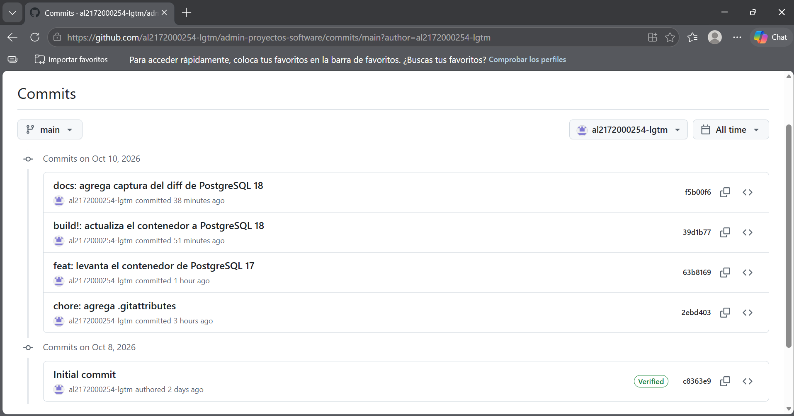

# Tarea 1 · Introducción a la administración de proyectos y entorno de trabajo

**UEA:** Administración de Proyectos de Software · **Clave:** 1151055
**Trimestre:** 26-O, otoño 2026
**Licenciatura:** Ingeniería en Computación
**División:** Ciencias Básicas e Ingeniería · **Departamento:** Sistemas
**Alumno:** Jesús Sánchez Aguilar · **Matrícula:** 2172000254
**Profesor:** M. en C. Gabriel Hurtado Avilés
**Fecha:** 10 de octubre de 2026

---

## Ejercicio 1 · El repositorio

- Repositorio público en GitHub con licencia **MIT**: [al2172000254-lgtm/admin-proyectos-software](https://github.com/al2172000254-lgtm/admin-proyectos-software).
- Archivo `.gitignore` con `data/`, `.env`, `Thumbs.db` y `.DS_Store`, creado **antes** del primer commit del ejercicio 3.
- Archivo `.gitattributes` tomado del material del curso, en la raíz.
- Historial con más de cinco confirmaciones en días distintos, con mensajes descriptivos.
- `README.md` en la raíz con liga a esta tarea, y este `README.md` con los datos académicos solicitados.

### Historial de confirmaciones

| # | Mensaje | Fase |
|---|---|---|
| 1 | `chore: agrega .gitattributes` | Fase 0 · repositorio |
| 2 | `feat: levanta el contenedor de PostgreSQL 17` | Fase A · PostgreSQL 17 |
| 3 | `build!: actualiza el contenedor a PostgreSQL 18` | Fase B · PostgreSQL 18 |
| 4 | `docs: agrega captura del diff de PostgreSQL 18` | Fase B · evidencia |
| 5 | `feat: agrega el stack MySQL + phpMyAdmin` | Fase C · MySQL |
| 6 | `docs: agrega README raíz con liga a tarea1` | Cierre · documentación |

---

## Ejercicio 2 · Investigación

### 2.1 ¿Qué es un proyecto de software?

Un **proyecto** es un esfuerzo **temporal** que se realiza para crear un **producto, servicio o resultado único** (Project Management Institute [PMI], 2021). "Temporal" no significa breve: significa que tiene un inicio y un fin definidos, y que termina cuando se alcanza el objetivo o cuando se cancela. "Único" significa que el resultado no existía antes, aunque se parezca a otros productos. A esto se le suma la **elaboración progresiva**: el detalle del plan crece conforme el equipo aprende durante el proyecto.

Es importante distinguir tres conceptos que suelen confundirse:

- **Proyecto**: el esfuerzo temporal con objetivo, equipo, presupuesto y fechas. Termina cuando cumple su objetivo.
- **Producto**: lo que se entrega y se usa. Sobrevive al proyecto: se mantiene, evoluciona y algún día se retira.
- **Proceso**: la forma repetible de trabajar (cómo se planea, se construye, se revisa y se libera). Se mejora de un proyecto a otro.

Un proyecto se distingue de la **operación continua** en que esta última es trabajo repetitivo y continuo que mantiene un producto existente (atender reportes, respaldar la base de datos, renovar certificados). La operación se mide por eficiencia y disponibilidad; el proyecto se mide por objetivos, valor y restricciones cumplidas.

Todo proyecto se administra sobre cuatro restricciones clásicas que se equilibran entre sí:

- **Alcance**: qué se entrega y, sobre todo, qué no.
- **Tiempo**: fechas, duración y dependencias.
- **Costo**: esfuerzo de las personas, infraestructura y licencias.
- **Calidad**: grado en que el producto cumple sus requisitos.

Mover una restricción presiona a las demás: más alcance con la misma fecha exige más esfuerzo o pone en riesgo la calidad (PMI, 2021).

### 2.2 ¿Cómo se administra un proyecto de software?

Un proyecto se administra combinando **marcos de referencia** (qué hacer) y **herramientas** (con qué). Los tres referentes que estudiamos en la unidad son el **PMBOK**, las normas **ISO 21500/21502** y **Scrum**.

La **Guía del PMBOK** (PMI) es un cuerpo de conocimiento y estándar. En su 6.ª edición organizó el trabajo en **5 grupos de procesos** (inicio, planificación, ejecución, monitoreo y control, cierre) y **10 áreas de conocimiento** (integración, alcance, cronograma, costos, calidad, recursos, comunicaciones, riesgos, adquisiciones e interesados). En su 7.ª edición pasó a **12 principios** y **8 dominios de desempeño**, más centrados en resultados y valor que en procesos prescriptivos (PMI, 2021). La 8.ª edición (2025) reincorpora orientación sobre procesos de forma no prescriptiva.

**ISO 21500:2021** especifica contexto y conceptos; **ISO 21502:2020** da directrices de prácticas de alto nivel para dirigir proyectos. Aplican a cualquier tipo de organización y de proyecto, y sirven como vocabulario común.

**Scrum** es un marco ágil ligero para generar valor mediante soluciones adaptativas a problemas complejos. Se organiza en **sprints** (ciclos de un mes o menos) con tres roles (Product Owner, Scrum Master, Developers), cinco eventos (Sprint, Sprint Planning, Daily Scrum, Sprint Review, Sprint Retrospective) y tres artefactos (Product Backlog, Sprint Backlog, Incremento) (Schwaber & Sutherland, 2020).

Los **modelos de proceso** se distinguen por cómo manejan la incertidumbre:

- **Predictivo (cascada)**: requisitos estables, tecnología madura, documentación por fases. Royce (1970) advirtió que probar sólo al final es riesgoso.
- **Iterativo**: repite ciclos para refinar el producto con retroalimentación. La espiral de Boehm (1988) añade análisis de riesgos en cada vuelta.
- **Ágil**: combina iteración e incremento. Cada sprint entrega algo utilizable y se adapta con lo aprendido (Beck et al., 2001).

**Para un proyecto como el de este curso**, con requisitos parcialmente conocidos, entregas semanales y cambios frecuentes, elegiría un **enfoque ágil tipo Scrum**. Permite entregar partes funcionales (PostgreSQL 17, PostgreSQL 18, MySQL) en ciclos cortos, revisar cada resultado y corregir. Un modelo predictivo puro obligaría a planear todo desde el inicio y no encajaría con imprevistos como la descarga fallida de una imagen de Docker.

### 2.3 ¿Con qué herramientas?

El entorno del curso se apoya en cuatro tipos de herramientas:

- **Control de versiones (Git)**: registra cada cambio con autor, fecha y mensaje. Permite volver a cualquier estado anterior y trabajar en ramas paralelas. Es la base del historial verificable que exige la tarea.
- **Tableros de trabajo (GitHub Projects, Issues)**: organizan el trabajo pendiente. Cada unidad de trabajo nace de un issue, lo que da trazabilidad entre lo planeado y lo hecho.
- **Contenedores (Docker)**: empaquetan la aplicación con sus dependencias en una **imagen** que se ejecuta igual en cualquier computadora. Resuelven el problema de "en mi máquina sí funciona".
- **Integración continua (GitHub Actions)**: ejecuta comprobaciones automáticas (build, pruebas) en cada push o pull request. No es requisito de esta tarea, pero sí de la Práctica 1.

Herramientas específicas del curso:

- **Docker frente a una máquina virtual**: la VM emula un equipo completo con su propio sistema operativo; arranca en minutos y ocupa gigabytes. El contenedor comparte el núcleo del sistema anfitrión y empaqueta sólo la aplicación; arranca en segundos.
- **Dockerfile frente a compose.yaml**: el `Dockerfile` es la receta de **una** imagen; se usa al construir. El `compose.yaml` describe **todo** el sistema (varios servicios, redes, volúmenes, puertos); se usa al levantar.
- **Volumen**: espacio de almacenamiento administrado por Docker que sobrevive al borrado del contenedor. Los contenedores son desechables; los datos no.
- **Comandos**:
  - `docker compose up -d`: levanta los servicios en segundo plano.
  - `docker compose exec`: ejecuta un comando dentro de un contenedor.
  - `docker compose stop`: detiene los contenedores sin borrarlos.
  - `docker compose down`: detiene y borra los contenedores (conserva volúmenes).
  - `docker compose ps`: muestra el estado de los servicios.
  - `docker compose logs`: muestra los mensajes del contenedor.

### 2.4 ¿Bajo qué licencia se distribuye el software?

Todo programa tiene una **licencia** que dice qué puede hacer con él quien lo recibe —usarlo, modificarlo, redistribuirlo, venderlo— y con qué obligaciones. Al crear el repositorio de esta tarea se eligió una.

#### a) Los dos grandes tipos

- **Permisivas** (MIT, BSD, Apache 2.0): permiten usar, modificar, redistribuir y vender el software; **no** obligan a liberar el código derivado con la misma licencia. La única obligación habitual es conservar el aviso de copyright.
- **Copyleft** (GPL, LGPL, AGPL): permiten usar, modificar y redistribuir, pero **obligan** a que el código derivado se distribuya bajo la misma licencia. Garantizan que el software y sus derivados sigan siendo libres.

| Licencia | Permite uso comercial | Permite modificar | Permite redistribuir | Obliga a liberar código derivado | Obliga a conservar aviso |
|---|---|---|---|---|---|
| MIT | Sí | Sí | Sí | No | Sí |
| BSD 2/3 | Sí | Sí | Sí | No | Sí |
| Apache 2.0 | Sí | Sí | Sí | No (sí aviso de cambios) | Sí |
| GPL | Sí | Sí | Sí | Sí | Sí |
| LGPL | Sí | Sí | Sí | Sí (con matices) | Sí |
| AGPL | Sí | Sí | Sí | Sí (incluso por red) | Sí |

#### b) Mi elección: MIT

El repositorio usa **MIT** porque es la licencia más simple y permisiva. Ventajas:

- Cualquiera puede reutilizar, modificar o aprender del código sin trámites.
- Es la más compatible con otros proyectos y con el ámbito académico.
- Sólo exige conservar el aviso de copyright.

Si hubiera elegido **GPL**, cualquiera que reutilizara el código tendría que publicar también su versión bajo GPL. Eso protege la libertad del software, pero limita su reutilización en proyectos cerrados. Para una tarea académica, MIT es la opción más abierta.

#### c) Caso real: MySQL, Oracle y MariaDB

MySQL fue creado en 1995 por MySQL AB y liberado bajo **GPL**. En 2008, Sun Microsystems compró MySQL AB; en 2010, Oracle compró Sun. La comunidad temió que Oracle cambiara las condiciones (por ejemplo, con ediciones privativas o licencias más restrictivas). En 2009, **Michael "Monty" Widenius** (fundador de MySQL) bifurcó el proyecto y creó **MariaDB**, compatible a nivel de protocolo y de API.

**La clave**: como MySQL estaba bajo **GPL**, cualquiera podía tomar el código, modificarlo y redistribuirlo **sin pedirle permiso a Oracle**. Eso es exactamente lo que permite el copyleft: garantiza que el código siga siendo libre aunque cambie de dueño. Si MySQL hubiera sido **MIT**, Oracle podría haber cerrado el proyecto sin liberar los cambios, y la comunidad no habría tenido el código base para crear MariaDB.

---

## Ejercicio 3 · De PostgreSQL 17 a 18

En `tarea1/postgres/` se levantó primero el contenedor del **22 de septiembre** (`1-postgres17/`) y después el nuevo (`2-postgres18/`). Los dos se comprobaron igual: con `docker compose ps` y consultando la versión.

### Diferencias entre los dos contenedores

| Aspecto | Viejo (17) | Nuevo (18) | Por qué cambió |
|---|---|---|---|
| Nombre del archivo | `docker-compose.yml` | `compose.yaml` | El nombre actual es `compose.yaml`; `docker-compose.yml` es el antiguo. |
| Primera línea | `version: '3.8'` | No hay | Compose V2 ignora `version` y avisa que es obsoleta. |
| Imagen | `postgres:17` | `FROM postgres:18.6` | Versión mayor nueva, fijada. |
| Datos | `./data:/var/lib/postgresql/data` | `datos_db:/var/lib/postgresql` | El volumen con nombre sobrevive a `down`; además PostgreSQL 18 cambió el punto de montaje. |
| Contraseña | escrita: `postgres` | `${POSTGRES_PASSWORD:-...}` | Sale del entorno (`.env`), que no se versiona. |
| Puerto | `"5432:5432"` | `"127.0.0.1:5434:5432"` | Se expone sólo en la máquina local y en un puerto distinto para no chocar. |
| Healthcheck | No | Sí | El nuevo espera a que la base acepte conexiones. |
| Interfaz web | No | Adminer en 8080 | Se agregó para inspeccionar la base sin instalar cliente. |
| Carpeta del proyecto dentro | No | `./:/trabajo` | Para ejecutar los scripts del material. |

### ¿Se usaba el Dockerfile viejo?

Sí. En el `docker-compose.yml` viejo, el servicio `postgres` tenía una directiva `build:` que apuntaba al `Dockerfile` de la carpeta, y `image:` nombraba el resultado. El `docker compose up -d --build` construía la imagen local `postgres-1151055:26o` a partir de ese Dockerfile. El nuevo `compose.yaml` también usa `build: .` con `image: postgres-1151055:26o`.

### Versionado semántico

El **versionado semántico** (SemVer) usa tres números: `MAYOR.MENOR.PARCHE` (por ejemplo, `18.6.0`).

- **MAYOR**: cambios que rompen compatibilidad.
- **MENOR**: se agregan funciones sin romper compatibilidad.
- **PARCHE**: sólo se corrigen errores.

Pasar de **17 a 18** es un **cambio mayor** porque, aunque el protocolo y SQL se mantienen, hay cambios incompatibles: por ejemplo, el punto de montaje de datos cambió de `/var/lib/postgresql/data` a `/var/lib/postgresql`. Un contenedor de PostgreSQL 18 no puede montar el directorio de datos de 17 directamente; en producción se requiere respaldo y migración (Docker Docs, 2026; semver.org).

---

## Ejercicio 4 · Otro stack: MySQL + phpMyAdmin

En `tarea1/mysql/` se llenaron los 11 huecos de la plantilla con la tabla de equivalencias y se levantó el stack. Se comprobó igual que los otros: con `docker compose ps` y consultando la versión.

### Tabla comparativa: PostgreSQL + Adminer vs. MySQL + phpMyAdmin

| Aspecto | PostgreSQL + Adminer | MySQL + phpMyAdmin |
|---|---|---|
| Imagen de la base | `postgres:18.6` | `mysql:9.7.2` |
| Contraseña del administrador | `POSTGRES_PASSWORD` | `MYSQL_ROOT_PASSWORD` |
| Nombre de la base | `POSTGRES_DB` | `MYSQL_DATABASE` |
| Usuario | `POSTGRES_USER` | `MYSQL_USER` |
| Contraseña del usuario | `POSTGRES_PASSWORD` | `MYSQL_PASSWORD` |
| Puerto interno | `5432` | `3306` |
| Carpeta de datos | `/var/lib/postgresql` | `/var/lib/mysql` |
| Interfaz web | `adminer:5.5.1` | `phpmyadmin:5.2.3` |
| Puerto web | `8080` | `80` |
| Variable de conexión | `ADMINER_DEFAULT_SERVER: db` | `PMA_HOST: db` |
| Espera a la base | `condition: service_healthy` | `condition: service_healthy` |
| Puerto en la máquina | `5434` | `3307` |
| URL en el navegador | http://localhost:8080 | http://localhost:8081 |

### LTS frente a innovation

- **LTS** (*Long Term Support*): versión estable con soporte durante varios años. Se usa en producción. Ejemplo: `mysql:9.7.2`.
- **Innovation**: versión con las últimas funciones, pero con soporte corto y cambios frecuentes. Ejemplo: `mysql:latest`, que hoy entrega una versión *innovation*.

Se usa **`mysql:9.7.2`** y no `mysql:latest` porque `latest` no significa "estable": significa "la última que subieron". Fijar la versión completa garantiza que el sistema siga funcionando dentro de un año, cuando alguien clone el repositorio.

---

## Ejercicio 5 · Capturas

### 1. PostgreSQL 17: `up -d --build` con el aviso de `version`

### 2. PostgreSQL 17: `ps` y `SELECT version();`

### 3. PostgreSQL 18: `ps` con `(healthy)` y `SELECT version();`

### 4. PostgreSQL 18: Adminer con las tablas

### 5. Diff del commit a la versión 18, en GitHub

### 6. phpMyAdmin con `SELECT VERSION();`

### 7. Docker Desktop con los dos stacks encendidos

### 8. Historial de confirmaciones en GitHub

---

## Declaración de uso de inteligencia artificial

Para elaborar esta tarea se utilizó **ChatGPT (OpenAI)** como apoyo en la explicación de conceptos (contenedores, licencias, versionado semántico, marcos de administración) y en la redacción de borradores del README. Las fuentes citadas provienen de la bibliografía del curso y de la documentación oficial de Docker, Git y GitHub. El alumno revisó, comprendió y ajustó el contenido antes de subirlo al repositorio, y asume la responsabilidad de lo entregado.

---

## Referencias

Beck, K., Beedle, M., van Bennekum, A., Cockburn, A., Cunningham, W., Fowler, M., Grenning, J., Highsmith, J., Hunt, A., Jeffries, R., Kern, J., Marick, B., Martin, R. C., Mellor, S., Schwaber, K., Sutherland, J., & Thomas, D. (2001). *Manifiesto por el Desarrollo Ágil de Software*. https://agilemanifesto.org/iso/es/manifesto.html

Boehm, B. W. (1988). A spiral model of software development and enhancement. *Computer, 21*(5), 61–72.

Docker Inc. (2026). *Docker Compose*. Docker Docs. https://docs.docker.com/compose/

Docker Inc. (2026). *Docker Documentation*. https://docs.docker.com

Project Management Institute. (2021). *A Guide to the Project Management Body of Knowledge (PMBOK Guide)* (7.ª ed.). PMI.

Royce, W. W. (1970). Managing the development of large software systems. *Proceedings of IEEE WESCON*, 1–9.

Schwaber, K., & Sutherland, J. (2020). *La Guía de Scrum*. https://scrumguides.org

Sommerville, I. (2004). *Ingeniería de Software* (7.ª ed.). Addison Wesley.
