# Tarea 2. Entorno móvil e inteligencia artificial con MCP

**Universidad Autónoma Metropolitana — Unidad Azcapotzalco**  
**UEA:** Administración de Proyectos de Software  
**Clave:** 1151055  
**Trimestre:** 26-O  
**Alumno:** Jesús Sánchez Aguilar  
**Fecha:** 17 de octubre de 2026

---

## Índice

- [1. Objetivo](#1-objetivo)
- [2. Entorno de desarrollo móvil](#2-entorno-de-desarrollo-móvil)
- [3. Evidencias del entorno móvil](#3-evidencias-del-entorno-móvil)
- [4. Investigación documental](#4-investigación-documental)
- [5. Comparación entre API y MCP](#5-comparación-entre-api-y-mcp)
- [6. Implementación del servidor MCP](#6-implementación-del-servidor-mcp)
- [7. Configuración del servidor de archivos](#7-configuración-del-servidor-de-archivos)
- [8. Pruebas de funcionamiento](#8-pruebas-de-funcionamiento)
- [9. Prueba de seguridad y aislamiento](#9-prueba-de-seguridad-y-aislamiento)
- [10. Conclusiones](#10-conclusiones)
- [11. Declaración de uso de inteligencia artificial](#11-declaración-de-uso-de-inteligencia-artificial)
- [12. Referencias](#12-referencias)

---

## 1. Objetivo

Documentar la preparación de un entorno de desarrollo móvil y estudiar el uso del Model Context Protocol (MCP) para conectar una aplicación de inteligencia artificial con herramientas externas. También se configura un servidor MCP de sistema de archivos limitado a un directorio de trabajo para comprobar el descubrimiento y uso de herramientas, así como la importancia de restringir el acceso a los recursos.

El trabajo reúne la investigación conceptual, la configuración utilizada, las pruebas de funcionamiento y las evidencias correspondientes.

## 2. Entorno de desarrollo móvil

Para la preparación del entorno móvil se utilizaron las siguientes herramientas y dispositivos:

| Componente | Versión o característica |
|---|---|
| Sistema operativo de desarrollo | Windows 11 de 64 bits |
| Android Studio | Quail 3, versión 2026.1.3 |
| Flutter | 3.47.7 |
| Dart | 3.13.5 |
| Android SDK | Android 17, API 37 |
| Dispositivo físico | Xiaomi 12 Pro |
| Sistema operativo del dispositivo | Android 13, API 33 |

Estas herramientas permiten preparar, compilar y ejecutar aplicaciones móviles. Android Studio proporciona el entorno de desarrollo y las herramientas del SDK; Flutter permite construir interfaces multiplataforma, y Dart es el lenguaje utilizado por Flutter.

## 3. Evidencias del entorno móvil

Las siguientes imágenes documentan la configuración y las actividades realizadas durante la preparación del entorno móvil.

> Las rutas son relativas al directorio de este README. Las imágenes deben encontrarse dentro de la carpeta `img`.

### 3.1. Configuración del entorno

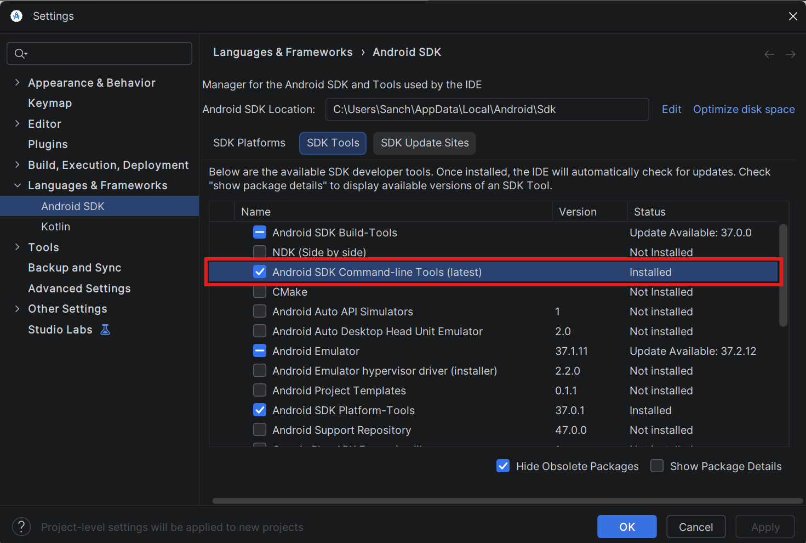

**Figura 1.** Configuración del SDK de Android mediante SDK Manager.

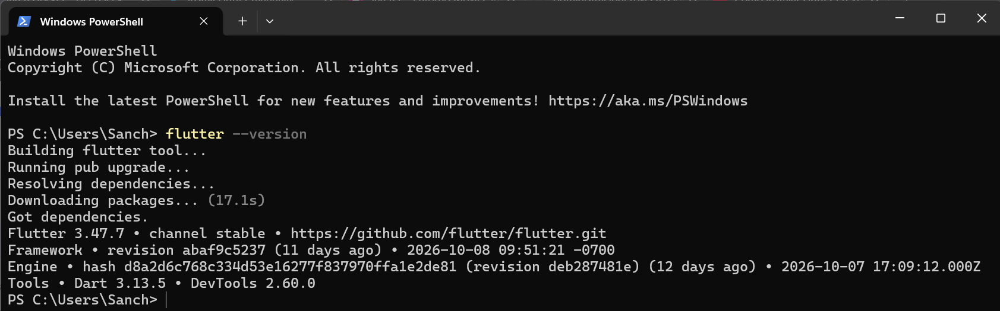

**Figura 2.** Entorno de desarrollo Android Studio.

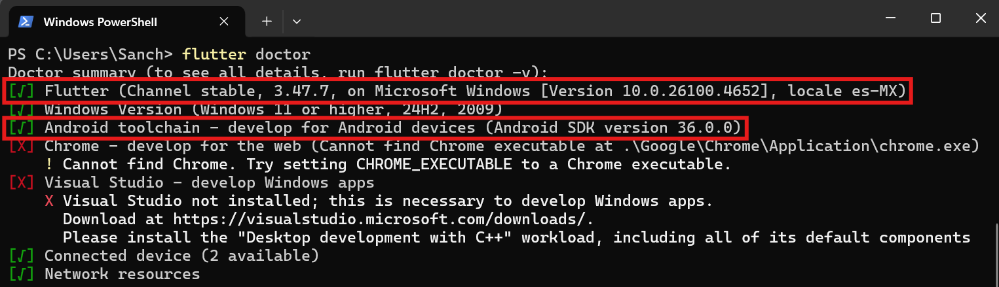

**Figura 3.** Comprobación de las herramientas de Flutter mediante `flutter doctor`.

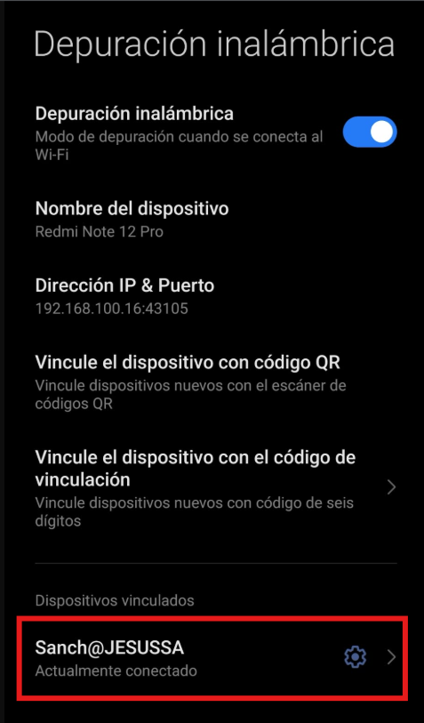

**Figura 4.** Opciones de desarrollador y depuración USB activadas en el teléfono.

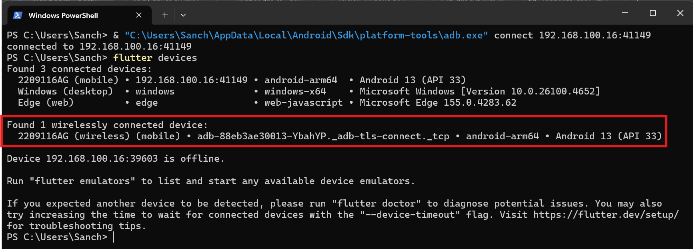

**Figura 5.** El teléfono aparece en la lista de `flutter devices`.


**Figura 6.** Evidencia de la aplicación HolaMundoFlutter ejecutada.


**Figura 7.** Evidencia de la aplicación HolaMundoKMP ejecutada durante la práctica.

## 4. Investigación documental

La investigación se organiza en siete documentos complementarios:

| Documento | Tema | Contenido |
|---|---|---|
| [01-evolucion.md](docs/01-evolucion.md) | Evolución de la inteligencia artificial | Modelos de lenguaje, LLM y evolución de sus capacidades. |
| [02-aislamiento.md](docs/02-aislamiento.md) | Aislamiento y acceso | Relación entre el modelo, la aplicación anfitriona y los recursos externos. |
| [03-mcp-vs-api.md](docs/03-mcp-vs-api.md) | MCP frente a API | Diferencias, relación y complementariedad entre ambos conceptos. |
| [04-arquitectura.md](docs/04-arquitectura.md) | Arquitectura de MCP | Host, cliente, servidor, herramientas, recursos y transporte. |
| [05-servidor-archivos.md](docs/05-servidor-archivos.md) | Servidor de archivos | Configuración y funcionamiento de un servidor MCP de sistema de archivos. |
| [06-seguridad.md](docs/06-seguridad.md) | Seguridad | Riesgos, permisos, aislamiento y principio de mínimo privilegio. |
| [07-casos-uso.md](docs/07-casos-uso.md) | Casos de uso | Aplicaciones y entornos que pueden integrarse con MCP. |

Los documentos desarrollan los fundamentos necesarios para comprender cómo una aplicación de inteligencia artificial puede descubrir y utilizar capacidades externas mediante un protocolo común.

## 5. Comparación entre API y MCP

Una API (*Application Programming Interface*) define una interfaz mediante la cual un software puede solicitar operaciones o datos a otro sistema. MCP (*Model Context Protocol*) estandariza la comunicación entre aplicaciones de inteligencia artificial y servidores que ofrecen herramientas, recursos y plantillas de instrucciones.

| Característica | API | MCP |
|---|---|---|
| Propósito | Exponer operaciones o datos de un sistema. | Estandarizar la conexión de aplicaciones de IA con capacidades externas. |
| Interfaz | Depende del diseño y contrato de cada API. | Define una estructura común para descubrir y utilizar capacidades. |
| Descubrimiento | Depende de la documentación y de la implementación. | Permite descubrir herramientas y otras capacidades expuestas por el servidor. |
| Comunicación | Puede utilizar HTTP, bibliotecas, RPC u otros mecanismos. | Utiliza mensajes JSON-RPC 2.0 y transportes definidos por el protocolo. |
| Integración con IA | Requiere que la aplicación adapte la API a sus necesidades. | Proporciona una interfaz común para que el cliente de IA interactúe con servidores compatibles. |
| Relación | Puede ser consumida directamente por una aplicación o por un servidor MCP. | Puede actuar como capa de integración y utilizar API existentes. |

MCP no sustituye a las API. Ambos pueden complementarse: un servidor MCP puede utilizar una API existente y exponer sus operaciones como herramientas accesibles para una aplicación de inteligencia artificial.

El protocolo tampoco concede acceso automático a los archivos o servicios del equipo. Las capacidades efectivamente disponibles dependen de los servidores configurados, sus permisos y las restricciones de la aplicación anfitriona.

## 6. Implementación del servidor MCP

### 6.1. Aplicación cliente

Se utilizó Claude Desktop como aplicación anfitriona y cliente de MCP. La integración se realizó mediante un servidor de sistema de archivos compatible con el protocolo.

### 6.2. Servidor seleccionado

Se utilizó el paquete `@modelcontextprotocol/server-filesystem`, que permite exponer operaciones sobre archivos y directorios mediante herramientas MCP.

El servidor puede ofrecer herramientas para listar directorios, leer archivos, crear o modificar contenido y buscar información, según la versión instalada. Los nombres y parámetros concretos de las herramientas dependen de la implementación.

### 6.3. Directorio de trabajo

Se estableció el siguiente directorio como ámbito de trabajo del servidor:

`C:\Users\Sanch\mcp-test`

La intención es que las operaciones de la práctica se realicen dentro de esa carpeta, en lugar de conceder acceso indiscriminado al sistema de archivos.

El directorio se utiliza para crear archivos de prueba y comprobar las operaciones disponibles desde la aplicación cliente.

## 7. Configuración del servidor de archivos

La configuración de Claude Desktop incorpora el servidor de archivos y especifica la ruta permitida como argumento de ejecución.

Archivo de configuración utilizado: `claude_desktop_config.json`.

Configuración JSON:

```json
{
  "mcpServers": {
    "filesystem": {
      "command": "npx",
      "args": [
        "-y",
        "@modelcontextprotocol/server-filesystem",
        "C:\\Users\\Sanch\\mcp-test"
      ]
    }
  }
}
```
### 7.1. Descripción de los parámetros

- `mcpServers`: contiene los servidores MCP configurados en la aplicación.
- `filesystem`: identificador asignado a esta conexión.
- `command`: indica el ejecutable que inicia el servidor; en este caso, `npx`.
- `args`: especifica el paquete que se ejecuta y el directorio de trabajo autorizado.
- `-y`: permite que `npx` acepte automáticamente la confirmación de instalación o ejecución solicitada por el paquete.

Después de guardar la configuración, la aplicación cliente debe reiniciarse o recargar la conexión para establecer la comunicación con el servidor.

**Consideración de seguridad:** indicar un directorio en la configuración limita el ámbito previsto de la herramienta, pero la seguridad efectiva también depende de la implementación del servidor, sus validaciones y los permisos del proceso que lo ejecuta. Por ello, es importante realizar una prueba de acceso fuera del directorio autorizado.

## 8. Pruebas de funcionamiento

Las pruebas tienen como finalidad comprobar la comunicación entre la aplicación cliente y el servidor, así como el funcionamiento de las herramientas expuestas.

### 8.1. Descubrimiento y listado de archivos

Se comprobó la disponibilidad de las herramientas del servidor y se utilizó la operación de listado para consultar el contenido del directorio de trabajo.

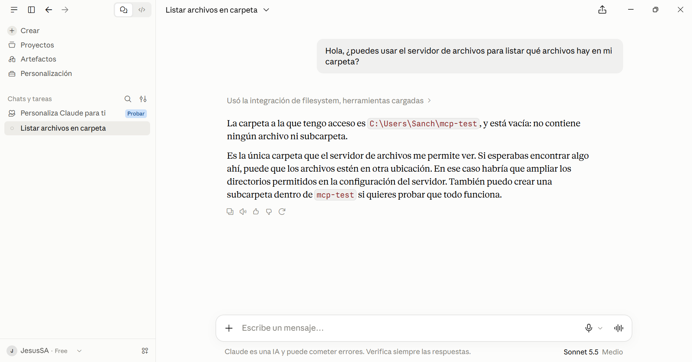

**Figura 7.** Evidencia del listado de herramientas o archivos mediante MCP.

### 8.2. Creación de archivos

Se utilizó la herramienta de escritura para crear un archivo de prueba dentro del directorio autorizado.

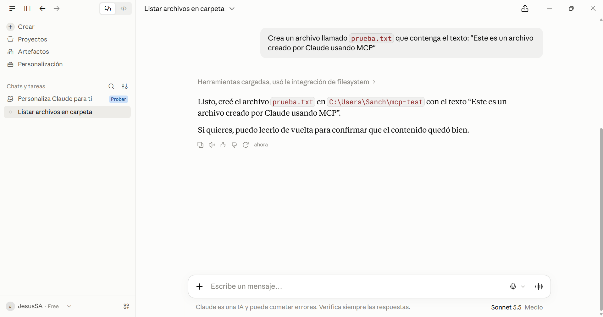

**Figura 8.** Evidencia de la creación de un archivo mediante el servidor MCP.

### 8.3. Lectura de archivos

Se consultó el contenido de un archivo de prueba para comprobar que el servidor podía recuperar la información solicitada.

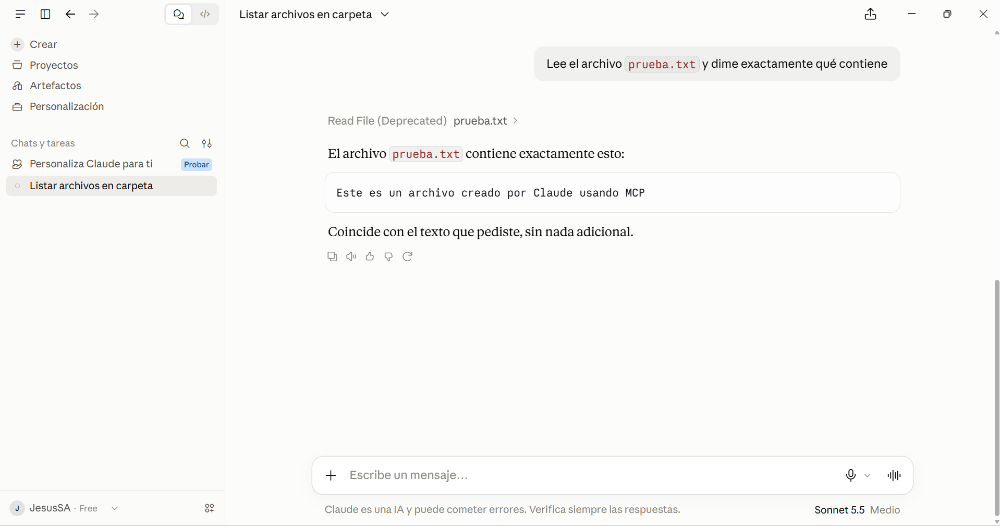

**Figura 9.** Evidencia de la lectura del contenido de un archivo.

### 8.4. Modificación de archivos

Se realizó una operación de modificación sobre un archivo de prueba para verificar la escritura de contenido actualizado.

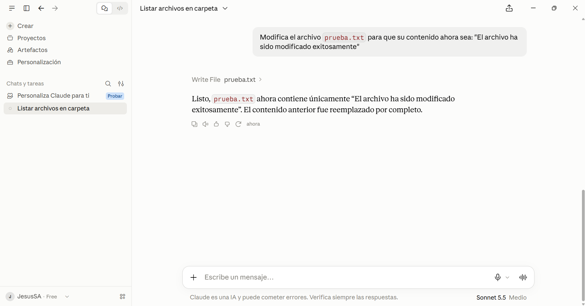

**Figura 10.** Evidencia de la modificación de un archivo mediante MCP.

### 8.5. Búsqueda de contenido

Se utilizó una operación de búsqueda para localizar archivos o contenido coincidente dentro del ámbito de trabajo.

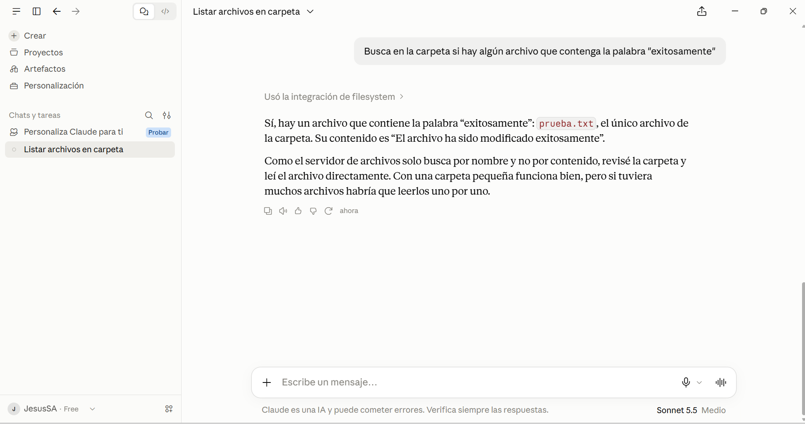

**Figura 11.** Evidencia de la búsqueda realizada mediante las herramientas del servidor.

## 9. Prueba de seguridad y aislamiento

La prueba de seguridad tiene como objetivo verificar que el servidor no permita acceder a rutas que se encuentren fuera del directorio autorizado.

El directorio configurado es:

`C:\Users\Sanch\mcp-test`

La comprobación consiste en solicitar una operación sobre una ruta situada fuera de esa carpeta y observar la respuesta del servidor. El comportamiento esperado es que la solicitud sea rechazada o que el recurso no pueda consultarse debido a las restricciones del servidor.

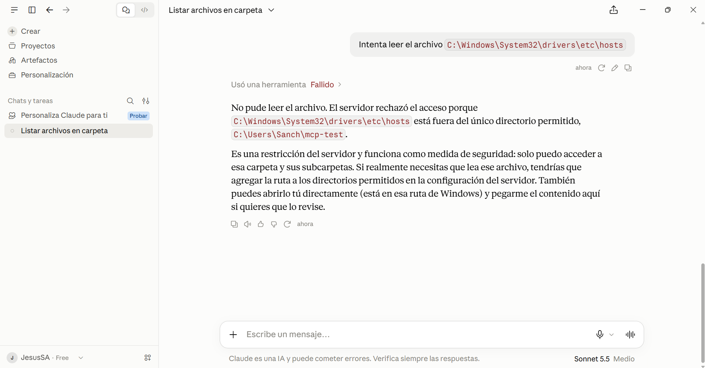

**Figura 12.** Evidencia de la prueba de acceso fuera del directorio autorizado.

### 9.1. Importancia de la restricción de acceso

Limitar los recursos disponibles reduce la posibilidad de que una instrucción incorrecta o maliciosa provoque el acceso no deseado a archivos personales o información confidencial.

Entre las medidas relevantes se encuentran:

- Aplicar el principio de mínimo privilegio.
- Conceder acceso únicamente a los directorios necesarios.
- Validar las rutas recibidas por las herramientas.
- Evitar almacenar credenciales o información sensible en archivos de prueba.
- Revisar las operaciones de escritura y eliminación.
- Comprobar el comportamiento real de las restricciones, sin asumir que la configuración por sí sola garantiza el aislamiento.

La seguridad depende tanto de la configuración como de la implementación y los permisos efectivos del proceso.

## 10. Conclusiones

La preparación del entorno móvil permitió reunir las herramientas necesarias para el desarrollo y la ejecución de aplicaciones, mientras que la investigación sobre MCP permitió comprender una forma estandarizada de conectar aplicaciones de inteligencia artificial con servicios externos.

La comparación entre API y MCP muestra que sus funciones son distintas y complementarias. Una API expone las operaciones de un sistema; MCP proporciona un protocolo común para que una aplicación compatible pueda descubrir y utilizar capacidades ofrecidas por servidores.

La implementación del servidor de archivos ilustra cómo una aplicación anfitriona puede acceder a herramientas externas sin que el modelo de lenguaje tenga acceso automático al sistema operativo. El acceso depende de la integración, de las capacidades expuestas y de los permisos establecidos.

Finalmente, las pruebas de listado, creación, lectura, modificación y búsqueda permiten evaluar el funcionamiento de las herramientas disponibles. La prueba de seguridad destaca que restringir el directorio de trabajo es una medida importante, pero debe acompañarse de validaciones y comprobaciones efectivas para reducir el riesgo de acceso no autorizado.

En conjunto, la actividad permitió relacionar los conceptos de inteligencia artificial, protocolos de comunicación, integración de software y seguridad, además de mostrar la importancia de documentar la configuración y las evidencias de una implementación.

## 11. Declaración de uso de inteligencia artificial

Se utilizó una herramienta de inteligencia artificial como apoyo para organizar y redactar la documentación, aclarar conceptos relacionados con los modelos de lenguaje, las API y el Model Context Protocol, y revisar la estructura del documento.

La herramienta se empleó como apoyo al proceso de aprendizaje y elaboración del trabajo. La configuración del entorno, las pruebas técnicas y las evidencias deben corresponder a las actividades realizadas por el estudiante. El contenido final se presenta bajo la responsabilidad del autor, quien debe comprenderlo y poder explicar las decisiones técnicas documentadas.

## 12. Referencias

Anthropic. (s. f.). *Getting started with local MCP servers on Claude Desktop*. Claude Help Center. https://support.claude.com/en/articles/10949351-getting-started-with-local-mcp-servers-on-claude-desktop

Google. (s. f.). *MCP*. Google Antigravity Documentation. https://antigravity.google/docs/mcp

Model Context Protocol. (2024). *Specification: 2024-11-05*. https://modelcontextprotocol.io/specification/2024-11-05

Model Context Protocol. (s. f.). *Filesystem server*. GitHub. https://github.com/modelcontextprotocol/servers

Cursor. (s. f.). *Model Context Protocol (MCP)*. Cursor Documentation. https://cursor.com/docs/mcp

Zed Industries. (s. f.). *Model Context Protocol*. Zed Documentation. https://zed.dev/docs/ai/mcp

Universidad Autónoma Metropolitana, Unidad Azcapotzalco. (2026). *Tarea 2: Entorno móvil e inteligencia artificial con MCP* [Instrucciones de la actividad académica].